# Thiết kế thông tin Độ rộng thị trường

Tài liệu này định nghĩa cấu trúc thông tin cho khu vực **Độ rộng thị trường** trên trang Tổng quan. Sơ đồ được dùng như khung tổ chức dữ liệu và giao diện; nó không phải API hay schema đã triển khai.

## Org chart đề xuất

```mermaid
flowchart TD
    A[Độ rộng thị trường\nUniverse + session + observed_at]
    A --> B[Toàn cảnh nhanh]
    A --> C[Cấu phần độ rộng]
    A --> D[Thanh khoản & hoạt động]
    A --> E[Phân rã thị trường]
    A --> F[Xu hướng theo thời gian]
    A --> G[Chất lượng dữ liệu]

    B --> B1[A/D ratio]
    B --> B2[Chênh lệch A−D]
    B --> B3[Đã phân loại / tổng universe]
    B --> B4[Biến động bình quân]

    C --> C1[Tăng giá]
    C --> C2[Đứng giá]
    C --> C3[Giảm giá]
    C --> C4[Phân bổ tỷ trọng]

    D --> D1[Khối lượng theo nhóm]
    D --> D2[Top khối lượng]
    D --> D3[Top giá trị giao dịch\nKhi provider có traded_value]
    D --> D4[Net flow\nKhi có aggressor side]

    E --> E1[Top tăng / giảm]
    E --> E2[Độ rộng theo ngành]
    E --> E3[Heatmap ngành]
    E --> E4[Đóng góp chỉ số\nKhi có index weight]

    F --> F1[A/D line]
    F --> F2[Breadth 1D / 5D / 20D]
    F --> F3[Phân kỳ với chỉ số]

    G --> G1[Quote coverage]
    G --> G2[Intraday / EOD / stale]
    G --> G3[Missing & partial state]
```

## Quy tắc bố cục

1. **Toàn cảnh nhanh** luôn đứng đầu để người dùng hiểu trạng thái trong vài giây.
2. **Cấu phần độ rộng** đặt ngay sau snapshot, dùng cùng màu tăng/giảm/đứng giá.
3. **Thanh khoản và phân rã** là các khối khám phá; có thể thu gọn trên mobile và không làm snapshot bị đẩy xuống khi dữ liệu phụ chưa sẵn sàng.
4. **Xu hướng theo thời gian** chỉ hiển thị khi có chuỗi quan sát liên tục; không nối điểm thiếu dữ liệu.
5. **Chất lượng dữ liệu** nằm cạnh tiêu đề hoặc cuối mỗi khối liên quan, để chú thích xuất hiện đúng nơi dữ liệu được sử dụng.

## Bản đồ dữ liệu

| Nhánh | Chỉ số | Trạng thái | Nguồn cần có |
| --- | --- | --- | --- |
| Toàn cảnh nhanh | A/D ratio, A−D, coverage | Đã có snapshot | Count tăng/giảm và universe |
| Cấu phần độ rộng | Count, %, volume theo nhóm | Đã có | Quote change, session volume |
| Thanh khoản | Top volume | Mốc 1 | Session quote |
| Thanh khoản | Traded value | Mốc 1 phụ thuộc provider | `traded_value` |
| Phân rã | Top tăng/giảm | Mốc 1 | Change + danh sách mã |
| Phân rã | Ngành/heatmap | Mốc 3 | Sector + change + volume |
| Xu hướng | A/D line, 5D/20D | Mốc 2 | Aggregate theo session |
| Dòng tiền | Net flow, foreign flow | Mốc 4 | Aggressor side / foreign buy-sell |

## Trình tự triển khai UI

- **Hiện tại:** giữ snapshot A/D, A−D, coverage và ba nhóm tăng/giảm/đứng giá.
- **Tiếp theo:** thêm các danh sách Top tăng, Top giảm, Top khối lượng dưới nhánh Phân rã/Thanh khoản; mỗi danh sách có giới hạn, timestamp và liên kết lọc bảng cổ phiếu.
- **Sau đó:** thêm timeline A/D và bộ lọc 1D/5D/20D.
- **Cuối cùng:** heatmap ngành và net flow chỉ bật khi hợp đồng dữ liệu đáp ứng điều kiện tương ứng.

Mọi khối mới phải có empty state, stale state và nhãn nguồn. Không hiển thị số 0 thay cho trường chưa được provider quan sát.
