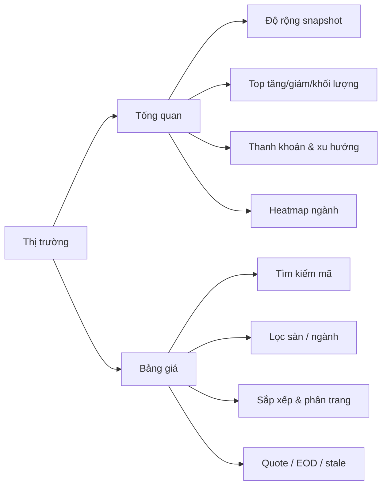

# Tách Tổng quan và Bảng giá

## Mục tiêu

Tách hai nhu cầu đang khác nhau:

- **Tổng quan:** trả lời “thị trường đang diễn biến thế nào?” bằng độ rộng, thanh khoản, Top list, ngành và cảnh báo chất lượng dữ liệu.
- **Bảng giá:** trả lời “mã nào đang ở mức giá/khối lượng nào?” bằng bảng dữ liệu có tìm kiếm, lọc, sắp xếp, phân trang và trạng thái quote.

## Cấu trúc điều hướng đề xuất

## Phân ranh giới

| Page | Trách nhiệm | Không nên chứa |
| --- | --- | --- |
| Tổng quan | Snapshot, breadth, Top list, ngành, xu hướng, cảnh báo data quality | Bảng 500 dòng và thao tác sắp xếp chi tiết |
| Bảng giá | Danh sách mã, quote, tìm kiếm/lọc/sắp xếp/phân trang, mở Chi tiết mã | Biểu đồ tổng hợp và diễn giải thị trường dài |

## Trạng thái dùng chung

Giữ `selectedSymbol`, `sector`, `exchange`, `coverage`, `sort` và thời điểm phiên trong một lớp query state dùng chung. Khi chuyển page:

- Tổng quan có thể truyền `sector`/`exchange` sang Bảng giá.
- Chọn một mã từ Top list mở Bảng giá với `q=SYMBOL` hoặc mở Chi tiết mã tùy hành động.
- Bảng giá không làm thay đổi snapshot Tổng quan ngoài việc dùng chung cache quote.

## Lộ trình chuyển đổi an toàn

1. Tạo route/view `market-overview` và `market-board` dùng cùng dữ liệu hiện tại.
2. Di chuyển `table-panel` thành `MarketBoardPage`, giữ nguyên test lọc/sắp xếp/phân trang.
3. Thêm nav “Bảng giá” và liên kết Top list → Bảng giá với query mã/sàn/ngành.
4. Chỉ sau khi acceptance pass mới bỏ bảng chi tiết khỏi Tổng quan.

Việc tách page không yêu cầu nhân đôi API; dùng lại `/api/stocks`, `/api/stocks/quotes` và cache quote chung. Đây là thiết kế chuyển đổi, chưa phải hợp đồng route đã triển khai.
